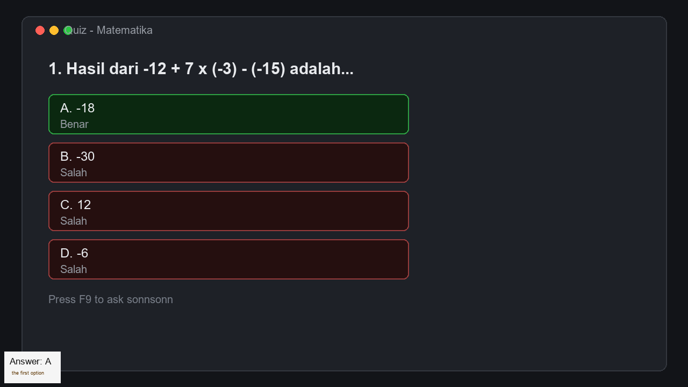

# sonnsonn


**Tekan F9, jawaban soal di layar muncul lewat kedipan CapsLock dan kotak kecil
di pojok layar.**



## Fitur

- **F9** menangkap layar utama dan mengirimnya ke model vision — tidak ada file
  yang disimpan.
- **CapsLock**: A–F = 1–6 kedipan. Pilihan tanpa huruf mengikuti urutan tampil
  (atas ke bawah, lalu kiri ke kanan).
- **Kotak jawaban** opsional: 5 posisi sudut, skala 50–200 %, tidak merebut
  fokus keyboard, menutup sendiri.
- **Jawaban esai** (termasuk sub a/b/c) dijawab **singkat dan to the point**
  (1–3 kalimat) dan disimpan ke `latest-answer.txt`. Kotak jawabannya membesar
  mengikuti panjang teks, jadi paragrafnya tampil utuh tanpa terpotong.
- **Thinking** off/low/high/max (default `high`) untuk soal hitungan.
- **Pencarian web** untuk soal yang butuh fakta terkini.
- **Provider bebas**: endpoint apa pun yang kompatibel OpenAI.

## Kebutuhan

Windows 10/11 · Python 3.10+ · API key DeepSeek atau endpoint vision lain

## Instalasi cepat

1. Unduh **`sonnsonn.zip`** dari
   [Releases](https://github.com/Hdiddz/sonn-sonn-display-answer/releases/latest).
2. Ekstrak ke folder yang bisa ditulis — bukan `C:\Program Files`.
3. Klik dua kali **`sonnsonn.cmd`**. Run pertama membuat `.venv` dan memasang
   dependensi (±1 menit, butuh internet).
4. Di menu konsol pilih **`[6] API key`**, tempel key Anda, lalu **`[1]`** untuk
   mulai. Hentikan dengan `stop.cmd`.

Dari source:

```powershell
git clone https://github.com/Hdiddz/sonn-sonn-display-answer.git
cd sonn-sonn-display-answer
py -3 -m venv .venv
.\.venv\Scripts\python.exe -m pip install -r requirements.txt
.\sonnsonn.cmd
```

## Cara pakai

| Aksi | Caranya |
|---|---|
| Ambil gambar + jawab | tekan **F9** |
| Baca jawaban esai | klik dua kali `open-answer.cmd` |
| Hentikan monitor | klik dua kali `stop.cmd` |
| Ubah pengaturan | klik dua kali `sonnsonn.cmd` |

Setiap capture mengirim seluruh layar utama dan memakai kredit. Tunggu jawaban
sebelum menekan F9 lagi; jawaban esai bisa sampai 90 detik. Tahan **Alt** untuk
membatalkan capture.

## Menu pengaturan

```
  ╔════════════════════════════════════════════════════════╗
  ║  sonnsonn   screen answer reader                       ║
  ╚════════════════════════════════════════════════════════╝

     popup      on              thinking  high
     position   bottom-left     scale     100%
     duration   2s              hotkey    F9
     api key    sk-4...e246     model     deepseek-flash
     endpoint   https://api.deepseek.com

   ── START ───────────────────────────────────────────────
     [1]  Answer box + CapsLock flashes
     [2]  CapsLock flashes only
   ── DISPLAY & BRAIN ─────────────────────────────────────
     [3]  Popup position        [4]  Popup size
     [5]  Box duration          [6]  Thinking effort
   ── CONNECTION ──────────────────────────────────────────
     [7]  API key               [8]  Model / endpoint
     [0]  Exit
```

- Pengaturan disimpan di `.monitor-settings` dan **dibaca ulang tiap jawaban**,
  jadi perubahan langsung berlaku tanpa restart.
- Kalau monitor sudah aktif, menunya berubah jadi menu kontrol:
  `[1]` stop · `[2]`/`[3]` sembunyikan/tampilkan kotak · `[4]` pindah ·
  `[5]` ukuran · `[6]` durasi kotak · `[7]` thinking · `[8]` tutup.
- **Durasi kotak** (`[5]`) bisa 1–30 detik, default 2 detik.
- Label menu sengaja bahasa Inggris agar cocok dengan tampilan aplikasi.

Posisi: `bottom-left`, `bottom-right`, `top-left`, `top-right`, `center`.

## Jawaban

A = 1 kedip, B = 2, C = 3, D = 4, E = 5, F = 6. Jawaban esai dan status "tidak
ada soal" memakai nada berbeda (bila suara diaktifkan; build default senyap).

## Model dan provider

Default **DeepSeek**, bisa diganti lewat menu `[7]` atau `.env`:

```ini
DEEPSEEK_API_KEY=sk-...
DEEPSEEK_MODEL=deepseek-flash
DEEPSEEK_BASE_URL=https://api.deepseek.com
```

| Provider | Base URL | Contoh model |
|---|---|---|
| DeepSeek (default) | `https://api.deepseek.com` | `deepseek-flash` |
| OpenAI | `https://api.openai.com/v1` | `gpt-4o` |
| OpenRouter | `https://openrouter.ai/api/v1` | model vision apa pun |
| Ollama (lokal, gratis) | `http://localhost:11434/v1` | `qwen2.5-vl` |

Syarat endpoint tujuan:

- menerima konten `image_url` → modelnya harus **vision**;
- mendukung `response_format: {"type": "json_object"}` → ini titik gagal paling
  umum, sebagian provider hanya mengizinkannya di model teks;
- nama model diisi di `DEEPSEEK_MODEL`.

Di luar DeepSeek, **thinking dan pencarian web otomatis dilewati** (keduanya
fitur khusus DeepSeek), bukan error. Nama variabel `DEEPSEEK_*` tetap dipakai
untuk semua provider. Kalau gagal, pesan HTTP-nya ada di `monitor.log`.

## Pencarian web

Kalau soal butuh informasi terkini, sonnsonn memanggil DeepSeek Search sekali
lalu menjawab ulang dari hasilnya. Biaya satu pencarian ($0.75 / 1.000) plus
satu permintaan teks. Kalau pencarian gagal, jawaban pertama tetap dipakai.
Matikan dengan `DEEPSEEK_SEARCH=off`.

## Pemecahan masalah

- **F9 tidak bereaksi** — jalankan dari Explorer Anda sendiri, bukan dari
  terminal/otomasi; proses low-integrity tidak bisa membaca keyboard. Cek
  `monitor.log` harus tertulis `integrity medium`. Coba juga **Fn+F9**.
- **"Monitor exited during startup"** — cek `monitor.log` dan
  `monitor-error.log`; biasanya API key kosong atau salah.
- **Kotak tidak muncul** — `popup=off`. Nyalakan dari menu `[3]`.
- **401 / 402** — key salah / saldo habis. Jawaban hitungan meleset — naikkan
  thinking ke `max` lewat `[5]`.

## Privasi dan etika

Tangkapan layar hanya di memori dan dikirim ke provider yang Anda pilih; tidak
ditulis ke disk kecuali memakai `--save-dir`. API key disimpan di `.env`
(di-ignore Git). Gunakan hanya di tempat yang mengizinkan bantuan luar — bukan
ujian atau asesmen yang melarangnya. Jawaban AI bisa salah.

## Pengembangan

```powershell
.\.venv\Scripts\python.exe -m unittest test_monitor.py   # 38 tes, tanpa jaringan
.\.venv\Scripts\python.exe monitor.py --selftest
```

`run_tests.py` mengubah LED CapsLock/NumLock sungguhan saat dijalankan.

## Lisensi

Belum ada lisensi — hak cipta dipegang penulis.
